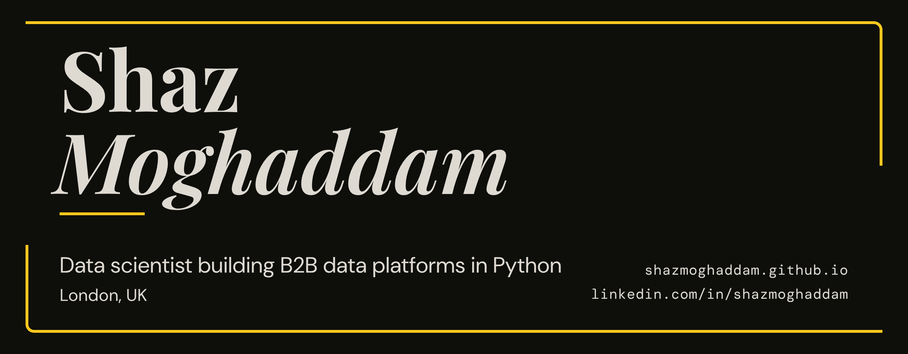

# Hi, I'm Shaz

Python and AI engineer based in London. I build data platforms that take messy, real-world input and turn it into something deployed, tested and usable: LLM-powered document extraction, ML anomaly detection, and analytics dashboards on FastAPI and Plotly Dash.

Trained through Imperial College London's Data Science Bootcamp (96% average). Looking for ML/AI engineering and data roles in London or remote.

[Portfolio](https://shazmoghaddam.github.io) · [LinkedIn](https://www.linkedin.com/in/shazmoghaddam/) · [DEV](https://dev.to/shazmoghaddam) · [Medium](https://medium.com/@shaz.moghaddam) · [Reddit](https://www.reddit.com/user/Aggravating_Pie2373/) · shaz.moghaddam@gmail.com

---

## Featured projects

My commercial products, LedgerLet, VoltScope, VoltEdge, ClinIQ and SalaryAxis, are published under [Moghaddam Labs](https://github.com/Moghaddam-Labs).

### [LedgerLet](https://ledgerlet.onrender.com): Making Tax Digital for UK landlords

Making Tax Digital for Income Tax means many UK landlords now have to keep digital records and send HMRC an update every quarter. LedgerLet keeps their property records and files those cumulative quarterly updates straight to HMRC. Landlords add income and expenses by hand or import a bank statement CSV through a two-step preview that blocks duplicate rows. Every figure is stored as integer pence and mapped to HMRC's property headings, with joint ownership shares and mortgage interest handled the way HMRC requires.

It connects to HMRC over OAuth with encrypted tokens, sends validated fraud prevention headers, checks obligations and deadlines, and keeps an append-only audit trail of every submission. It's a modular monolith with a React and TypeScript frontend whose types are generated from the API, and a CI gate of 600+ automated tests, including browser tests with accessibility checks at phone, tablet and laptop sizes. I also open-sourced its UX documentation approach as [ux-boards](https://github.com/ShazMoghaddam/ux-boards).

600+ tests · Auth0 sign-in (UK region) · [Live demo](https://ledgerlet.onrender.com), running end to end on HMRC's sandbox

`Python` `FastAPI` `PostgreSQL` `SQLAlchemy` `Alembic` `React` `TypeScript` `Vite` `Auth0` `HMRC MTD API` `Playwright` `GitHub Actions` `Docker`

### [VoltScope](https://github.com/Moghaddam-Labs/voltscope): LLM extraction and validation for UK energy bills

Commercial energy bills arrive as PDFs and phone photos in every layout you can imagine. VoltScope sends each one to Claude for schema-constrained extraction into a fixed Pydantic model, then runs deterministic checks the LLM shouldn't be trusted with: MPAN digit counts, subtotal and VAT reconciliation, duplicate charges, estimated reads and contract renewal windows.

The design principle is simple: the LLM does the reading, plain Python does the checking. 50 golden-file tests on real anonymised supplier bills keep the extraction honest.

`Python` `FastAPI` `Claude API` `Pydantic` `SQLite` `Docker`

### [VoltEdge](https://github.com/Moghaddam-Labs/voltedge): energy intelligence platform

Multi-site energy monitoring with per-site isolation forest anomaly detection, causal root-cause analysis using the PC algorithm, Scope 2 emissions reporting, and a Claude assistant that answers questions like "what caused the spike at the London factory last Thursday?" Runs on 90 days of simulated data across four site types.

903 tests · JWT auth with role-based access · [Live demo](https://voltedge-1k6q.onrender.com) (free tier, give it up to a minute to wake up)

`Python` `FastAPI` `Plotly Dash` `scikit-learn` `NetworkX` `Claude API` `Docker`

### [ClinIQ](https://github.com/Moghaddam-Labs/cliniq): clinical trial site performance

Tracks enrolment velocity, site risk scores and protocol deviations for mid-sized CROs, with an AI insights layer on top. Built in five phases with 496 tests.

`Python` `FastAPI` `Plotly Dash` `SQLAlchemy` `scikit-learn` `spaCy` `Claude API`

### [SalaryAxis](https://github.com/Moghaddam-Labs/salaryaxis): UK salary benchmarks from ONS data

Takes ONS Annual Survey of Hours and Earnings data, adjusts it for CPI inflation, and serves salary benchmarks by region and occupation through a REST API and React dashboard, including gender pay gap trends over time.

`Python` `Flask` `pandas` `SciPy` `React` `Docker`

### [CVLens](https://github.com/ShazMoghaddam/CVLens): NLP CV analyser

Parses PDF and Word CVs, detects sections, extracts skills with spaCy and generates readable quality feedback.

`Python` `spaCy` `PyMuPDF` `python-docx`

### [Lending Club](https://github.com/ShazMoghaddam/Lending_Club_Loan_Project): loan default prediction

Logistic regression model predicting loan default risk on Lending Club data. With balanced class weights it catches 59% of defaults across 451,786 held-out loans, at 21% precision, so it works as a first-pass risk flag rather than an approval decision.

`Python` `pandas` `scikit-learn`

---

## Open source

**[Bezel Charts](https://github.com/ShazMoghaddam/bezel-charts):** charts that look finished the moment you add them. Ten chart tiles drawn in pure SVG (bars, grouped bars, lines, donuts, rings, gauges, sparklines, a scatter plot with a trend line and Pearson's r, and an activity heatmap), each one HTML tag. Build a chart in the Studio from a CSV, Excel or JSON file, paste one line into any site, or export it as a static SVG for a README or slide. Light and dark themes, any locale, accessible to screen readers, about 12 kB gzipped with no dependencies. [Live Studio](https://shazmoghaddam.github.io/bezel-charts/site/) · [How I built it](https://dev.to/shazmoghaddam/charts-that-look-finished-the-moment-you-add-them-54jd)

`JavaScript` `Web Components` `SVG`

**[Bezel](https://github.com/ShazMoghaddam/bezel):** open-source clock, calendar and weather tiles, inspired by Apple's StandBy widgets. Five zero-dependency web components drawn in vectors, so they look the same at 120 px or across a 4K screen, with a Studio to design a tile and share it as a link, automatic dark mode, live weather from Open-Meteo and `.ics` calendar feeds. About 25 KB gzipped. [Live Studio](https://shazmoghaddam.github.io/bezel/site/) · [How I built it](https://dev.to/shazmoghaddam/apple-took-a-bite-out-of-theirs-so-i-made-the-whole-apple-bezel-open-source-clock-calendar-and-3o72)

`JavaScript` `Web Components` `SVG` `Container Queries`

**[World Map](https://github.com/ShazMoghaddam/world-map):** an interactive choropleth map of 172 countries across seven data layers, including GDP per capita, HDI, CO₂ per capita, life expectancy and internet use. Filter by region or political group (EU, G20, NATO, BRICS+), import your own CSV or JSON, share a view as a link or embed it with a JavaScript API. One HTML file, no dependencies, full keyboard navigation and dark mode. [Live demo](https://shazmoghaddam.github.io/world-map)

`JavaScript` `SVG` `HTML5`

**[ux-boards](https://github.com/ShazMoghaddam/ux-boards):** turn one YAML file into UX documentation boards (information architecture, navigation by screen size, wireframes and a visual system with WCAG contrast checks), exported as HTML, PDF and PNG. [Live examples](https://shazmoghaddam.github.io/ux-boards/)

`Python` `Jinja2` `Playwright` `GitHub Actions`

**[Orbs](https://github.com/ShazMoghaddam/orbs):** ten morphing dot-formation animations for the web, from a Fibonacci sphere to a rolling torus, and any shape can morph into any other. One file, about 5 KB gzipped, no dependencies, themed with plain CSS. [Live demo](https://shazmoghaddam.github.io/orbs/) · [How I built it](https://dev.to/shazmoghaddam/how-i-built-morphing-dot-animations-with-plain-canvas-no-libraries-5-kb-127h)

`JavaScript` `Canvas`

**[Strata Symbol Kit](https://github.com/ShazMoghaddam/strata-symbols):** 183 layered-line symbols, letters and numbers for designers. Adjust the line count, angle and colour in the browser, then export clean SVG, PNG or a full sprite. [Live editor](https://shazmoghaddam.github.io/strata-symbols/)

`JavaScript` `Python` `SVG`

---

## Data projects and community

**[House Prices & the Economy](https://github.com/ShazMoghaddam/uk-house-prices-economy):** a free monthly UK data challenge on how house prices rise and fall with jobs, pay, interest rates and the cost of living. Each month brings one plain-English question, free government data and three levels from beginner to expert. Anyone can take part by opening a pull request. November 2026: booms and busts.

`Python` `pandas` `matplotlib` `UK House Price Index` `ONS`

**[Top 50 Universities 2027](https://github.com/ShazMoghaddam/top-universities-2027):** the world's top 50 universities from the THE World University Rankings 2027, with each one's location, score and what it's best known for. One Python script turns a CSV into a designed PDF carousel for LinkedIn and 1080×1350 slides for Instagram, and a check script confirms every figure in the PDF matches the data.

`Python` `Playwright` `SVG` `GitHub Actions`

---

## Writing

**Technical, on [DEV](https://dev.to/shazmoghaddam)**

- [Charts that look finished the moment you add them: Bezel Charts](https://dev.to/shazmoghaddam/charts-that-look-finished-the-moment-you-add-them-54jd)
- [Apple took a bite out of theirs, so I made the whole apple: Bezel, open-source clock, calendar and weather web components](https://dev.to/shazmoghaddam/apple-took-a-bite-out-of-theirs-so-i-made-the-whole-apple-bezel-open-source-clock-calendar-and-3o72)
- [How I built morphing dot animations with plain canvas, no libraries (5 KB)](https://dev.to/shazmoghaddam/how-i-built-morphing-dot-animations-with-plain-canvas-no-libraries-5-kb-127h)

**Personal essays, on [Medium](https://medium.com/@shaz.moghaddam)**

Reflections on becoming, connection, and the things that stay with you.

- [Co-Evolving](https://medium.com/@shaz.moghaddam/co-evolving-5e9567d9bcfb): on AI, socialising, and the quiet search for connection
- [The Weight of Enough](https://medium.com/@shaz.moghaddam/the-weight-of-enough-c338ef1df0e2): on consumption, pace, and what it means to have enough
- [One Ear, Two Kids, and Fifty Pints of Gratitude](https://medium.com/@shaz.moghaddam/one-ear-two-kids-and-fifty-pints-of-gratitude-328e444b2126): on hearing loss, fatherhood, and counting what counts
- [The Road Is Always Calling](https://medium.com/@shaz.moghaddam/the-road-is-always-calling-252fc652420f): on riding, growing up, and the things we pass on
- [Building Resilience in the Face of Change](https://medium.com/@shaz.moghaddam/building-resilience-in-the-face-of-change-d2f7bc777314): continuing forward when life doesn't go to plan
- [The Art of Unlearning](https://medium.com/@shaz.moghaddam/the-art-of-unlearning-1b14d5be3985): letting go of what no longer fits
- [The Art of Becoming](https://medium.com/@shaz.moghaddam/the-art-of-becoming-440d736a68fc): growth, identity, and the person you're still becoming

---

## What I work with

`Python` `pandas` `NumPy` `Jupyter` `scikit-learn` `spaCy` `SQL` `PostgreSQL` `SQLite` `SQLAlchemy` `Alembic` `FastAPI` `Flask` `Plotly Dash` `Streamlit` `Pydantic` `JavaScript` `TypeScript` `React` `Kotlin` `Flutter` `Docker` `Git` `pytest` `GitHub Actions` `Playwright` `Claude API` `Render` `Railway`

---

## Android apps

Seven apps published on Google Play, all free:

| App | What it does |
|---|---|
| [SearchWars](https://play.google.com/store/apps/details?id=com.searchwars.app) | Higher-or-lower game: which gets more Google searches? 3,187 questions across 11 categories. Built in Flutter |
| [World Builders](https://play.google.com/store/apps/details?id=com.shazmoghaddam.worldbuilders) | Open sandbox for shaping and growing a world at your own pace |
| [Math Adventure](https://play.google.com/store/apps/details?id=com.shazmoghaddam.mathadventure) | Story-led maths challenges for children aged 3 to 11 |
| [Bingo Maths](https://play.google.com/store/apps/details?id=com.ShazMoghaddam.bingomaths) | Maths practice with bingo mechanics |
| [Split Flap World Clock](https://play.google.com/store/apps/details?id=com.ShazMoghaddam.splitflapworldclock) | A split-flap departure board of live world clocks, 300+ cities |
| [Animated Month Wallpaper](https://play.google.com/store/apps/details?id=com.ShazMoghaddam.animatedmonthwallpaper) | Minimal live wallpaper showing the month, with a live clock |
| [Animated Weekday Wallpaper](https://play.google.com/store/apps/details?id=com.ShazMoghaddam.animatedweeklywallpaper) | Minimal live wallpaper showing the day of the week, with a live clock |

`Kotlin` `Java` `Flutter` `Android`

---

## Also built

A set of small developer tools, each with a live demo: [Regex Decoder](https://shazmoghaddam.github.io/regex-decoder/), [Cron Decoder](https://shazmoghaddam.github.io/cron-decoder/), [Python Exceptions](https://shazmoghaddam.github.io/python-exceptions/), [HTTP Status Codes](https://shazmoghaddam.github.io/http-status-codes/), [HTTP Headers](https://shazmoghaddam.github.io/http-headers/) and [Tech Acronyms](https://shazmoghaddam.github.io/tech-acronyms/).

I also design and sell digital products, including generative artwork like KNOK Matrix and Typography Digits, on [Gumroad](https://shazmogh.gumroad.com/), Envato and Lemon Squeezy: 25 digital products and 50+ projects in all. Everything is on [my website](https://shazmoghaddam.github.io).

---

Open to full-time, contract and freelance work. If you're building something with data or LLMs, I'd like to hear about it.

Shaz Moghaddam · London · [shazmoghaddam.github.io](https://shazmoghaddam.github.io)
